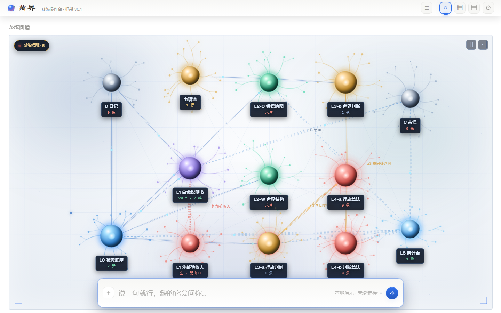
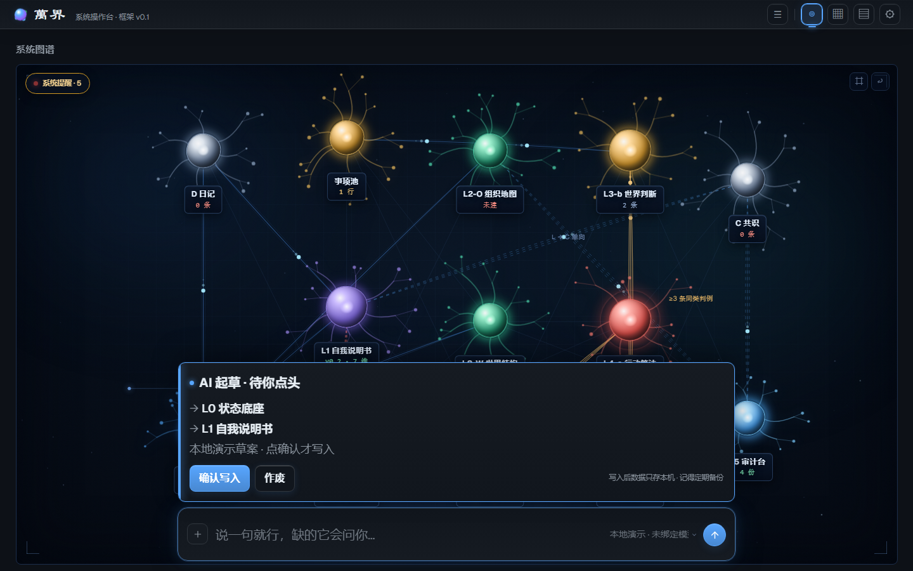
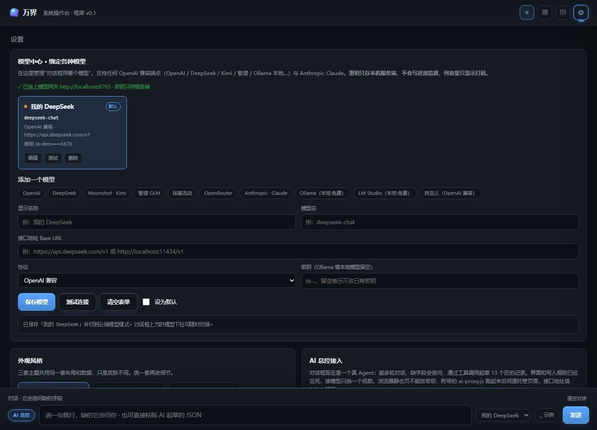

# 万界系统 · Wanjie

一个从零开始记录的个人 Agent。你说话，它追问、起草、校验，**你点头才落盘**。
像 DeepTutor 一样本机 Docker 一条命令跑起来，数据落本机不丢；能绑各种大模型；最终记录能检索回来。

> [!IMPORTANT]
> **在线体验**：`https://momoximing.github.io/wanjie-system/` （维护者：仓库 Settings → Pages → Source 选 GitHub Actions 后自动生成，其他人可直接点开体验）


> 架构铁律：**AI 只起草 → 规则校验 → 用户点头 → 才落盘**。所有写入都过这一关，绝不静默写库。

---

## 快速开始（Docker，推荐）

需要本机装好 Docker 与 Docker Compose。

```bash
# 1. 进入目录
cd wanjie

# 2. 一条命令启动
docker compose up -d

# 3. 浏览器打开
# http://localhost:8787
```

数据落在宿主机 `./data/` 目录（`db.json` 存全部记录，`models.json` 存模型配置）。
**删容器、换镜像、重启电脑都不丢**——只要别删 `./data`。

停止：`docker compose down`　查看日志：`docker compose logs -f`

端口被占用？改 `docker-compose.yml` 里的 `"8787:8787"` 为 `"8788:8787"`，再打开 `http://localhost:8788`。

## 不用 Docker 的最小跑法

需要 Node 18+，零依赖：

```bash
node ai-proxy.js
# 打开 http://localhost:8787
```

或者直接**双击 `index.html`**——纯离线、单文件、零依赖，数据存浏览器 localStorage（清缓存会丢，适合先体验）。

## 配模型

打开 `http://localhost:8787` → 顶栏 ⚙ 设置 → **模型中心**：

1. 点一个预设（DeepSeek / OpenAI / Kimi / 智谱 / Ollama 本地…）
2. 补上模型名和密钥（Ollama 等本地模型密钥留空）
3. 点「测试连接」→ 通过 → 点「设为默认」

密钥只存服务端 `./data/models.json`，**不进浏览器、前端只看到打码**。
配好后底部对话框会多出模型下拉，随时切换。没配模型也能用「本地演示」完整体验追问流程。

## 怎么用

底部输入框就是你唯一的录入口——像聊天一样说，AI 自动填进对应的区：

- 说「押注：这事一周内有回音」→ 它依次追问**到期日 / 那个数在哪 / 具名反方**，齐了才让你确认
- 点神经元 → 抽屉**只读查看**，带证据链（点来源 chip 跳到原始记录，断链标红）
- 同类判例够 3 条 → 冒出「一键起草 L4 算法」按钮，仍要你确认才写入
- 图谱左上角提醒徽标 / 看板顶部 → 主动提醒缺证据、审计到期等

## 数据存在哪

| 打开方式 | 存储位置 | 清浏览器缓存 |
|---|---|---|
| Docker / `node ai-proxy.js`（同源） | 服务端 `./data/db.json` 数据卷 | 不丢 |
| 双击 `index.html`（file://） | 浏览器 localStorage | 会丢 |

同源打开时会自动探测并切到服务端存储；设置页「数据存储与备份」卡片能看到当前模式和手动上传/刷新按钮。
localStorage 始终保留一份离线镜像。可随时「导出 JSON」备份。

## 安全边界（重要）

这是**本机工具**，默认不对外：`node ai-proxy.js` 只监听 `127.0.0.1`，Docker 的端口也只映射到宿主机回环（`127.0.0.1:8787:8787`）——同一网络的其它机器连不上。

- **不要**把端口映射到 `0.0.0.0` 或对外网开放。令牌（`WANJIE_TOKEN`）只能挡跨站浏览器请求；同一网络的人直接 `curl` 页面、取出页面内注入的令牌后，就能读走全部记录。真正的安全边界是**网络绑定**，不是令牌。
- 确实要从手机/局域网访问时：改 compose 端口为 `0.0.0.0:8787:8787` **并且**在 `.env` 设 `WANJIE_TOKEN`，更推荐用 SSH 隧道 / VPN，而不是直接暴露端口。
- 模型密钥只存服务端 `./data/models.json`，接口返回的永远是打码值（如 `sk-abcd••••wxyz`），不会泄露原文。密钥绝不写进前端。

若要对外开放，请自行评估网络安全；本项目默认配置面向本机单人使用。

---

## 检索自己记过的

顶栏 ▤ 进「全部档案」，顶部搜索框输入关键词即可：

- 多关键词用空格分隔（取交集），大小写不敏感
- 命中内容高亮，按相关度排序；上方 chip 可按模块筛选
- 点结果直接跳到那条记录并高亮

纯前端零依赖实现，记录多了也能秒搜。

## 快速体验（不想配模型）

设置 → 数据存储与备份 → **导入 JSON**，选 `examples/sample-db.json`（全虚构演示数据），
就能看到带证据链、提炼算法、多模块记录的完整效果。

## 跑测试

```bash
npm test
```

零依赖，Node 18+ 即可。覆盖：语法检查、前端关键能力断言、示例数据完整性、
服务端 `/data` 持久化（含**重启后数据保留**）、模型中心 CRUD 与密钥打码、静态托管。

## 项目结构

```
wanjie/
├── index.html              # 单文件前端（三主题 + 神经元图谱 + Agent 对话 + 存储适配器 + 全文检索）
├── ai-proxy.js             # 零依赖 Node 服务：静态托管 + 模型网关 + /data 持久化
├── Dockerfile              # 本机服务镜像（Node 20 / 非 root）
├── docker-compose.yml      # 一键启动 + ./data 数据卷 + healthcheck
├── .env.example            # 可选环境变量模板（复制为 .env）
├── .dockerignore/.gitignore# 排除数据、密钥、临时文件
├── package.json            # npm start / npm test
├── LICENSE                 # MIT
├── README.md               # 本文件
├── CHANGELOG.md            # 更新日志
├── CONTRIBUTING.md         # 贡献指南
├── RELEASE.md              # 维护者用：开源发布与推广手册
├── PLAN.md                 # 执行步骤与进度
├── docs/                   # README 用的截图
├── .github/
│   ├── workflows/
│   │   ├── pages.yml       # push 后自动部署在线体验版
│   │   └── test.yml        # push/PR 自动跑 npm test
│   └── ISSUE_TEMPLATE/     # bug / 功能建议模板
├── examples/
│   └── sample-db.json      # 脱敏示例数据（虚构）
├── test/
│   └── run-tests.js        # 零依赖自动化测试
└── data/                   # 运行时生成（不入库）：db.json（记录）+ models.json（模型/密钥）
```

## 界面预览

| | |
|---|---|
|  |  |
|  |  |
|  | |

## 路线图与进度

见 `PLAN.md`。8 步全部完成：Agent 对话机制、记忆闭环、模型中心、本地 Docker + 数据落卷、
检索自己记录的、开源发布、外观去 AI 味（观测台语言已回并到主线）。

v1.1.0 基于三方审查校准，补齐了"读路径"（历史档案参与对话）、数据主权加固，以及预测校准 /
健康度 / 风险分级确认 / 领域软标签 / 可选本地语义检索等增强。详见 `CHANGELOG.md`。
`npm test` 143 项全部通过。

## 可选：本地语义检索（默认关闭）

关键词检索零依赖、离线可用。想要"按意思找相似经历"时，可复用本机 Ollama / LM Studio 的
embedding 端点，在启动代理前设置：

```bash
WANJIE_EMBED=1 \
WANJIE_EMBED_URL=http://localhost:11434/v1 \
WANJIE_EMBED_MODEL=nomic-embed-text \
node ai-proxy.js
```

未设置或连接失败时自动回退到关键词检索，不影响任何功能。若填的是云端 URL，界面会提示
"档案文本将发往该服务"，请自行确认数据边界。

## License

MIT · 见 `LICENSE`。
